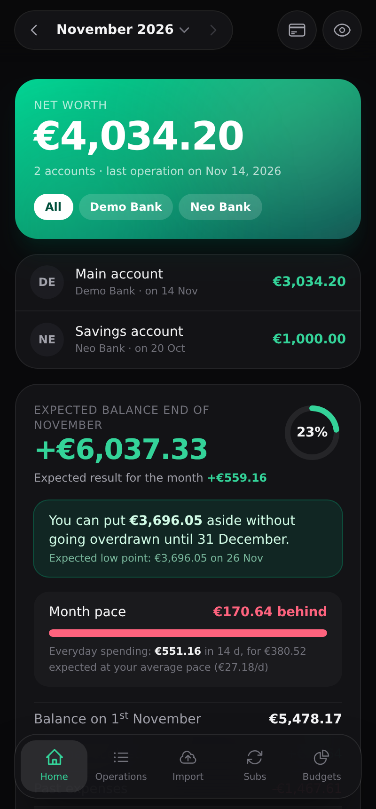
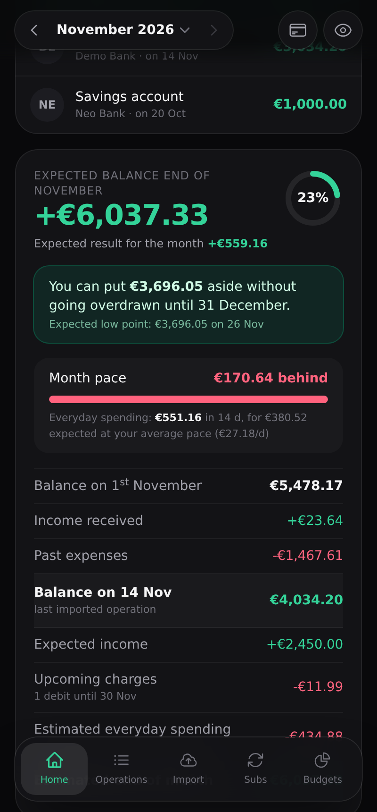
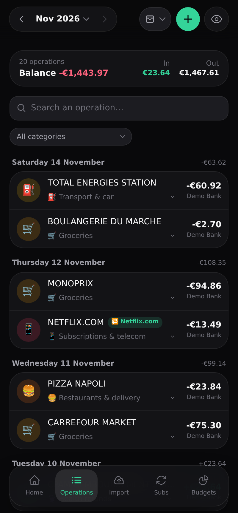
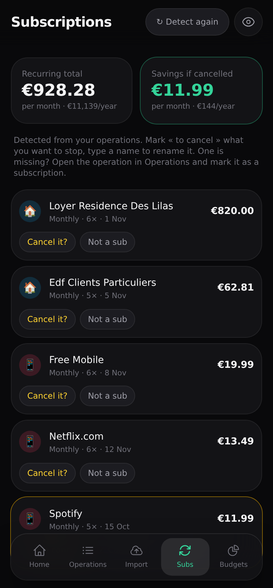
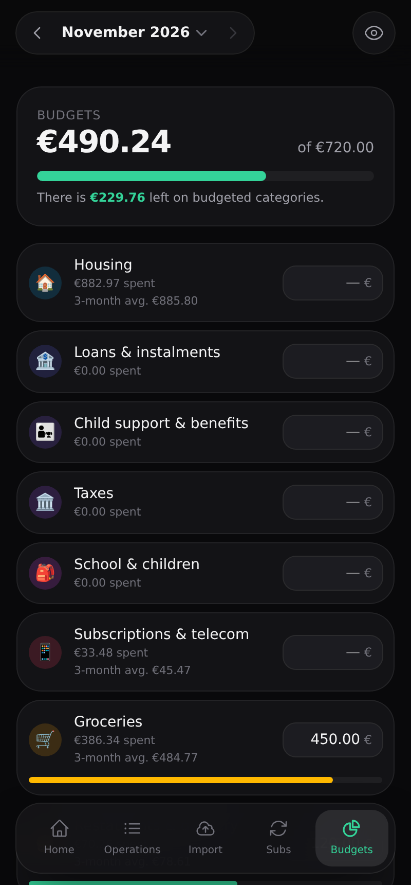
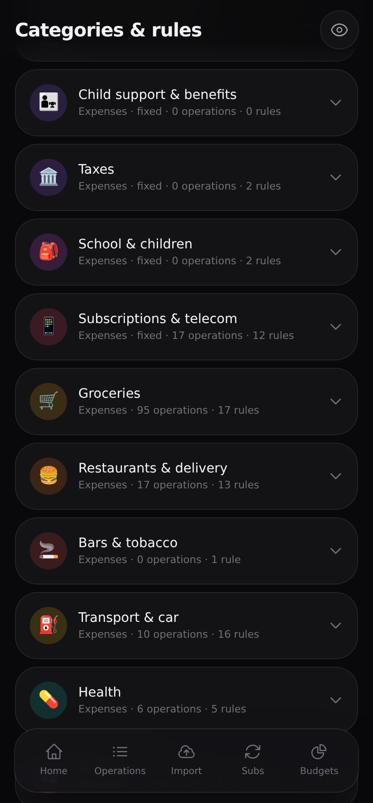

# Tirelire

A self-hosted, mobile-first personal budget app. Import your bank's CSV exports, let rules sort
your operations into categories, spot recurring payments, set monthly budgets and see where your
balance is heading by the end of the month.

Tirelire is meant for **one household**: one instance, one set of accounts, shared by the people
who manage the same money. Your data stays in a single SQLite file on your own server.

| | | |
|---|---|---|
|  |  |  |
|  |  |  |

*Screenshots taken on the demo data (`DemoSeeder`), every name and amount is made up.*

## Features

- **Several accounts**, with the current balance taken from the bank statement.
- **Bank CSV import**, format detected automatically: Crédit Mutuel, Trade Republic and N26 for
  now ([adding a bank](#adding-a-bank) is a single class). Importing overlapping files never creates
  duplicates, and an operation you typed by hand is replaced by the bank's line when it arrives.
- **Manual entry** of expenses and income.
- **Rule-based categorization**: a rule is a text searched in the bank label. Categories and rules
  are managed in the app, with a preview of the operations a rule matches and a one-click
  recategorization. Generic rules for common French retailers and services are included.
- **Recurring payments detection**: rent, loans, insurance, subscriptions (monthly and yearly),
  robust to one-off amounts and price changes. Mark one "to cancel" to see what you would save.
- **Monthly budgets** per category, with the average of the previous 3 months as a reference.
- **Forecast**: expected balance at the end of the month, the amount you can put aside without
  going overdrawn, the month's pace against your average, and the next charges.
- **Internal transfers** (savings, moves between your own accounts) are kept out of income and
  spending statistics.
- **Private mode** to hide amounts on screen in public places.
- **English and French** interface.

## Installation

### Docker (recommended)

```bash
git clone --branch v1.0.0 https://github.com/HiteaFR/tirelire.git
cd tirelire
docker compose pull
docker compose up -d
docker compose exec app php artisan finance:user you@example.com
```

Then open <http://localhost:8080> and log in with the email address and the password you just
chose.

- Everything that must survive an update (the SQLite database and the application key, generated
  on first start) lives in the `tirelire-data` volume. **Back it up.**
- On start, the container applies the database migrations. The generic categories and rules are
  created on the very first start only.
- The image runs as an unprivileged user and listens on port 8080. `compose.yaml` publishes it on
  `127.0.0.1` only: put a reverse proxy with HTTPS in front of it to reach it from elsewhere, and
  set `TRUSTED_PROXIES` and `SESSION_SECURE_COOKIE=true` (see [Configuration](#configuration)).
- Settings are passed as environment variables, for example in a `.env` file next to
  `compose.yaml` (`APP_LOCALE=fr`, `APP_TIMEZONE=Europe/Paris`…).
- The image `ghcr.io/hiteafr/tirelire` is published for `linux/amd64` and `linux/arm64` with each
  [release](https://github.com/HiteaFR/tirelire/releases); `compose.yaml` pins the image of its
  version. Check where an image comes from with
  `gh attestation verify oci://ghcr.io/hiteafr/tirelire:1.0.0 --repo HiteaFR/tirelire`.
- To update: read the release notes, then `git fetch --tags && git checkout v<version>`,
  `docker compose pull && docker compose up -d`.
- To build the image from source instead: `TIRELIRE_IMAGE=tirelire:local docker compose up -d --build`.
- To try it with made-up data: `docker compose exec app php artisan db:seed --class=DemoSeeder`
  (on an instance without operations only).

### Manual

Requirements: PHP 8.4 with the `pdo_sqlite` extension, Composer, Node 22 (to build the assets), a
web server (nginx with PHP-FPM, Caddy, FrankenPHP…) serving the `public/` directory.

```bash
git clone --branch v1.0.0 https://github.com/HiteaFR/tirelire.git
cd tirelire
composer install --no-dev --optimize-autoloader
npm ci && npm run build
cp .env.example .env            # then edit it, see Configuration
php artisan key:generate
php artisan migrate --seed      # tables, generic categories and rules
php artisan finance:user you@example.com
php artisan optimize
```

Make `storage/`, `bootstrap/cache/` and the directory of the SQLite database writable by the web
server user. Set `APP_ENV=production` and `APP_DEBUG=false`.

After an update: `composer install --no-dev --optimize-autoloader`, `npm ci && npm run build`,
`php artisan migrate --force`, `php artisan optimize`. Do not run `db:seed` again: it would recreate
the generic categories you deleted.

### Users

There is no public sign-up. Accounts are created, and passwords reset, from the command line:

```bash
php artisan finance:user you@example.com                 # asks for the password twice
FINANCE_USER_PASSWORD=… php artisan finance:user you@example.com --password-env --no-interaction
```

Passwords must be at least 12 characters long. Resetting a password logs out the sessions already
open. Every account sees all the data: Tirelire has no isolation between users.

## Configuration

Set in `.env` (manual installation) or as environment variables (Docker).

| Variable | Default | Description |
|---|---|---|
| `APP_NAME` | `Tirelire` | Name shown in the interface and the page titles. |
| `APP_URL` | `http://localhost` | Public URL of the instance. |
| `APP_KEY` | — | Encryption key (`php artisan key:generate`). Docker generates and keeps one in the volume when it is empty. Never change it once set. |
| `APP_LOCALE` | `en` | Interface language: `en` or `fr`. Generic categories are named in this language when they are created. |
| `APP_TIMEZONE` | `UTC` | Time zone used for "today", month boundaries and dates, e.g. `Europe/Paris`. |
| `DB_DATABASE` | `database/database.sqlite` | Path of the SQLite database (`/var/lib/tirelire/database.sqlite` in Docker). |
| `TRUSTED_PROXIES` | empty | IP addresses or CIDR ranges of your reverse proxies, comma-separated. Needed behind a proxy for HTTPS links and the real client IP. Avoid `*`: any client could then forge its IP and bypass the login throttling. |
| `TRUSTED_HOSTS` | empty | Host names accepted in the `Host` header, comma-separated. Empty: no restriction (let the web server filter). |
| `SESSION_SECURE_COOKIE` | `false` | Set to `true` when the app is served over HTTPS. |
| `SESSION_LIFETIME` | `120` | Minutes of inactivity before logging out ("remember me" excepted). |
| `FINANCE_CURRENCY_SYMBOL` | `€` | Currency symbol. Tirelire handles a single currency: this only changes the display. |
| `FINANCE_MONEY_FORMAT` | follows `APP_LOCALE` | Number format: `en` (€1,234.56), `fr` (1 234,56 €) or `de` (1.234,56 €). Formats are defined in `config/finance.php`. |
| `FINANCE_CATEGORY_RULES` | empty | Path of an optional JSON file of your own rules, loaded by `db:seed` (see below). |

### Your own categorization rules

Rules can be managed in the app (**Accounts → Categories & rules**). To keep rules that are
specific to you outside the app (your employer, your local shops…) and load them on a new
installation, write them in a JSON file and point `FINANCE_CATEGORY_RULES` to it before running
`php artisan db:seed`:

```json
[
    {"category": "salary", "pattern": "ACME CORP", "priority": 10},
    {"category": "groceries", "pattern": "MARKET STREET"}
]
```

`category` is the key of a shipped category (`salary`, `groceries`, `housing`, `subscriptions`…,
see `database/seeders/CategorySeeder.php`) or the name of an existing category. Patterns are
matched in upper case; the lowest priority is tried first (100 when omitted). Existing rules are
never modified by a new seed.

## Command line

| Command | Description |
|---|---|
| `php artisan finance:user {email}` | Create a user, or reset the password of an existing one. |
| `php artisan finance:import {file} [--account=ID]` | Import a bank CSV file, then detect recurring payments again. |
| `php artisan finance:recategorize [--pattern=TEXT] [--all]` | Apply the rules to existing operations (only uncategorized ones unless `--all`). |
| `php artisan db:seed --class=DemoSeeder` | Made-up demo data, on an instance without operations only. |

## Adding a bank

Each bank export is read by a small parser class: a name, a way to recognize the file from its
first line, and the conversion of each row into an operation. Adding one means writing that class,
registering it in `config/finance.php` and adding a test with an anonymized sample. The steps are
described in [CONTRIBUTING.md](CONTRIBUTING.md#adding-a-bank). If you cannot write it yourself,
open a "New bank format" issue with a made-up sample of the file.

## Good to know

- **One instance per household.** There is no multi-user isolation: everyone who can log in sees
  everything.
- **Private mode is purely cosmetic.** It hides amounts on screen, nothing more: it is not a
  security feature.
- **Your data is not encrypted at rest.** Protect the server, the Docker volume and the backups.
- **French bank formats first.** The generic rules target common French retailers and services;
  add your own rules for anything else.

See [SECURITY.md](SECURITY.md) for the security model and how to report a vulnerability.

## Development

Laravel 13, Livewire 4, Tailwind 4, SQLite. See [CONTRIBUTING.md](CONTRIBUTING.md).

```bash
php artisan test --compact
vendor/bin/pint --test
```

## License

Tirelire is licensed under the [Apache License 2.0](LICENSE). See [NOTICE](NOTICE) for third-party
material.
